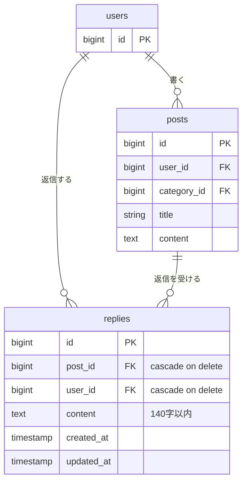

# リプライ機能 設計

Issue #1「ポストにリプライ機能を追加する」の設計。この文書は設計だけで、実装のコードは含まない。

## 概要

ポストを読んだ人が、その場で一言返せるようにする。今は読むだけで返す手段がないため、ポスト1件の詳細画面を新設し、そこでリプライの一覧表示・送信・削除ができるようにする。

決めたこと(Issue #1 での合意):

| 項目 | 内容 |
| --- | --- |
| 本文の文字数上限 | 140字以内(ポストと同じ) |
| 詳細画面への入口 | タイムラインのタイトルを `/posts/{post}` へのリンクにする |
| リプライの並び順 | 古い順(送信すると末尾に増える) |
| 削除できる人 | リプライを書いた本人のみ。判定は `PostPolicy` と同じやり方(`$user->id === $reply->user_id`) |
| 削除の連動 | ポストまたはユーザーが削除されたら、そのリプライも一緒に消える |

スコープ外: リプライへのリプライ(入れ子)、リプライの編集、タイムラインへのリプライ件数表示、ポスト所有者が他人のリプライを消す機能、リプライフォームの残り文字数表示。

## 受け入れ条件

Issue #1 の完成条件をそのまま写す。

1. ポストを1件開くと、そのポストとリプライの一覧が見える
2. 本文を入れてリプライを送ると、一覧に増える
3. 本文が空のままだと、エラーが表示されてリプライは増えない
4. 自分のリプライは消せて、他人のリプライは消せない

## 変えないもの

次の動きは変えない。回帰がないことをテストで確認する(「テスト観点」参照)。

- **タイムライン(`/posts`)**: ポストの並び(新しい順)、表示内容、「編集」「削除」ボタンの出し分け(`@canany` / `@can`)はそのまま。変わるのはタイトルがリンクになる点だけ
- **ポストの編集・更新・削除**: ルート、`PostPolicy`(オーナーのみ)、バリデーション(本文140字以内、CRLF→LF の正規化)、完了後に `posts.index` へ戻る動きは変更しない。既存の `PostContentLimitTest` も無修正で通ること
- **認証まわり**: Fortify のルートと画面、ログイン後の遷移先(`/posts`)
- **認可の方式**: `PostPolicy` は変更しない。リプライ用に `ReplyPolicy` を別に作る(自動検出されるので `AuthServiceProvider::$policies` は空のまま)
- **バリデーションの置き場所**: FormRequest にせず、コントローラ内の `$request->validate` で行う

ポストを削除すると、ぶら下がるリプライも DB のカスケードで一緒に消える。リプライがあってもポストの削除は失敗しない。

## 増えるテーブル

`replies` テーブルを1つ追加する。既存のテーブルは変更しない。

`users` と `posts` は既存テーブルで、関係の説明に必要な列だけを載せている。

### `replies` の列

| 列 | 型 | 制約 | 説明 |
| --- | --- | --- | --- |
| `id` | bigint unsigned | PK | |
| `post_id` | bigint unsigned | FK → `posts.id`、削除時カスケード | 返信先のポスト |
| `user_id` | bigint unsigned | FK → `users.id`、削除時カスケード | リプライを書いた人。削除可否の判定に使う |
| `content` | text | NOT NULL | 本文。長さの上限(140字)はテーブルではなくバリデーションで守る(`posts.content` と同じ) |
| `created_at` / `updated_at` | timestamp | | 並び順(`created_at` の古い順、同時刻は `id` 順)に使う |

### モデルの関係

- `Post` 1–n `Reply`(`Post::replies()`、`Reply::post()`)
- `User` 1–n `Reply`(`User::replies()`、`Reply::user()`)
- `Reply` の `$fillable` は `post_id` / `user_id` / `content`

## 増える画面

### ルート

すべて `auth` ミドルウェアのグループ内に置く。未ログインはログイン画面へリダイレクトされる。

| メソッド | URL | 名前 | コントローラ | 役割 |
| --- | --- | --- | --- | --- |
| GET | `/posts/{post}` | `posts.show` | `PostController@show` | ポスト詳細(ポスト+リプライ一覧+送信フォーム) |
| POST | `/posts/{post}/replies` | `replies.store` | `ReplyController@store` | リプライを送信 |
| DELETE | `/replies/{reply}` | `replies.destroy` | `ReplyController@destroy` | リプライを削除(本人のみ) |

存在しない `{post}` / `{reply}` は 404。

### ポスト詳細画面(`resources/views/posts/show.blade.php`、新規)

既存の画面に合わせ、共通レイアウトなし・インライン `<style>`・日本語の文言で作る。

- **ヘッダ**: ブランド(`posts.index` へのリンク)と、「ホーム」へ戻るリンク
- **ポスト本体**: 投稿者名・投稿日時・トピック・タイトル・本文を表示する。表示のみで、編集・削除ボタンは置かない(それらはタイムラインの役割のまま)
- **リプライ一覧**: 古い順。1件ごとに投稿者名・日時・本文を表示する。自分のリプライにだけ「削除」ボタンを出す(`@can('delete', $reply)`)
- **0件のとき**: 「まだリプライがありません。」と表示する
- **送信フォーム**: 本文の `textarea` と「返信」ボタン。送信先は `replies.store`。入力チェックに失敗したら同じ画面に戻り、入力済みの本文を保持(`old('content')`)してエラーを `textarea` の下に表示する

### 既存画面の変更

- `posts/index.blade.php`: ポストのタイトルを `route('posts.show', $post)` へのリンクにする。ボタン・並び順・表示内容は変更しない

### 画面遷移

- タイムライン → タイトルをクリック → ポスト詳細
- ポスト詳細で送信成功 → ポスト詳細に戻る(一覧の末尾に増えている)
- ポスト詳細で入力エラー → ポスト詳細に戻る(エラー表示、リプライは増えない)
- ポスト詳細でリプライ削除 → ポスト詳細に戻る
- ポスト詳細の「ホーム」/ブランド → タイムライン

## 入力チェックとメッセージ一覧

### ルール(`ReplyController@store`)

送信前に、`PostController@update` と同じく CRLF を LF に揃えてから数える(ブラウザは改行を CRLF で送るため)。

| 項目 | ルール |
| --- | --- |
| `content` | `required\|string\|max:140` |

前後の空白は Laravel 標準の `TrimStrings` で削られるため、空白や改行だけの本文は「空」として `required` で弾かれる。

### メッセージ

アプリのロケールは `en` で日本語の言語ファイルもないため、既存の `content.max` と同様にコントローラで日本語のメッセージを明示する。

| 場面 | 条件 | 表示するメッセージ |
| --- | --- | --- |
| 本文が空 | `content` が未入力・空白のみ | リプライを入力してください。 |
| 本文が文字列でない | `content` が配列など | リプライは文字列で入力してください。 |
| 141字以上 | 改行を1字として数えて141字以上 | リプライは140字以内で入力してください。 |

表示位置は `textarea` の下(`@error('content')`、既存の `.error` スタイル)。エラー時はリプライを作らない。

### 入力チェック以外のエラー

| 場面 | 結果 |
| --- | --- |
| 他人のリプライを削除しようとした | 403。リプライは残る |
| 存在しないポスト・リプライを指定した | 404 |
| 未ログインで詳細・送信・削除にアクセスした | ログイン画面へリダイレクト。リプライは増減しない |

## テスト観点

`tests/Feature/ReplyTest.php`(案)に書く。既存テストと同じく `RefreshDatabase` を使い、MySQL の `testing` DB で動かす。

### 正常系

| # | 観点 | 期待結果 |
| --- | --- | --- |
| 1 | ポスト詳細を開く | 200。ポストの本文とリプライ本文が表示される |
| 2 | リプライが複数ある | 古い順に並んで表示される |
| 3 | リプライが0件 | 「まだリプライがありません。」が表示される |
| 4 | 本文ありで送信 | `posts.show` にリダイレクトされ、`replies` が1件増える(`post_id` と `user_id` が正しい) |
| 5 | 140字ちょうどで送信 | 保存される |
| 6 | CRLF 入りで合計140字(改行を1字と数える)で送信 | 保存される。改行は LF で保存される |
| 7 | 自分のリプライを削除 | `posts.show` にリダイレクトされ、リプライが消える |

### 異常系

| # | 観点 | 期待結果 |
| --- | --- | --- |
| 8 | 本文が空で送信 | `content` に「リプライを入力してください。」のエラー。リプライは増えない |
| 9 | 空白・改行だけで送信 | 8 と同じ |
| 10 | 141字で送信 | `content` に「リプライは140字以内で入力してください。」のエラー。リプライは増えない |
| 11 | エラー後の画面 | エラーメッセージと、入力済みの本文が表示される |
| 12 | 他人のリプライを削除 | 403。リプライは残る |
| 13 | 存在しないポストの詳細・送信 | 404 |
| 14 | 未ログインで詳細・送信・削除 | ログイン画面へリダイレクト。リプライは増減しない |

### 表示の出し分け

| # | 観点 | 期待結果 |
| --- | --- | --- |
| 15 | 自分のリプライ | 「削除」ボタンが出る |
| 16 | 他人のリプライ | 「削除」ボタンが出ない |
| 17 | ポスト所有者が見る他人のリプライ | 「削除」ボタンが出ない(所有者でも消せない) |

### 回帰(変えないもの)

| # | 観点 | 期待結果 |
| --- | --- | --- |
| 18 | タイムライン | 各ポストのタイトルが `posts.show` へのリンクになっている。「編集」「削除」の出し分けは従来どおり |
| 19 | リプライ付きのポストを削除 | ポストが消え、リプライも一緒に消える(エラーにならない) |
| 20 | ユーザーを削除 | そのユーザーのリプライも消える |
| 21 | 既存の `PostContentLimitTest` | 無修正で通る |
